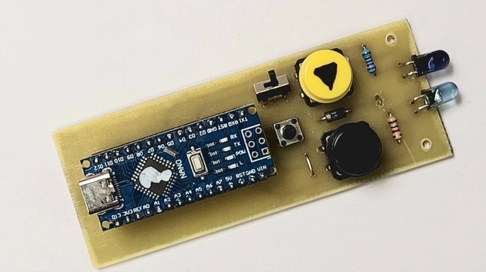

# [Стартовый модуль](/DIY_edition/Hardware/tsop48.pdf) представляет собой ИК-приемник на 38 кГц

[Программа для Arduino IDE](/DIY_edition/Software/TSOP_as_start_module.ino)

-------
# [Судейский пульт](/DIY_edition/Hardware/Schematic_DIY_referee_remote.pdf) на Arduino nano

[Программа для Arduino IDE](/DIY_edition/Software/Referee_remote.ino)

| Файл | Назначение |
|------|------------|
| [Schematic_DIY_referee_remote.pdf](/DIY_edition/Hardware/Schematic_DIY_referee_remote.pdf)| Принципиальная схема |
| [PCB_DIY_Referee_remote_top_layer.pdf](/Hardware/PCB_DIY_Referee_remote_top_layer.pdf) | Расположение деталей на верхнем слое |
| [PCB_DIY_Referee_remote_bottom_layer.pdf](/Hardware/PCB_DIY_Referee_remote_bottom_layer.pdf) | Нижний слой платы для ЛУТ |