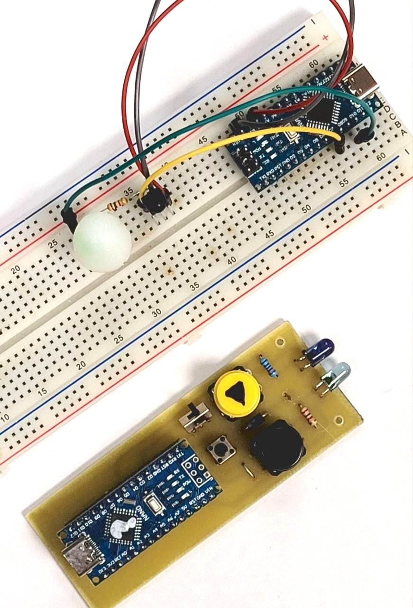
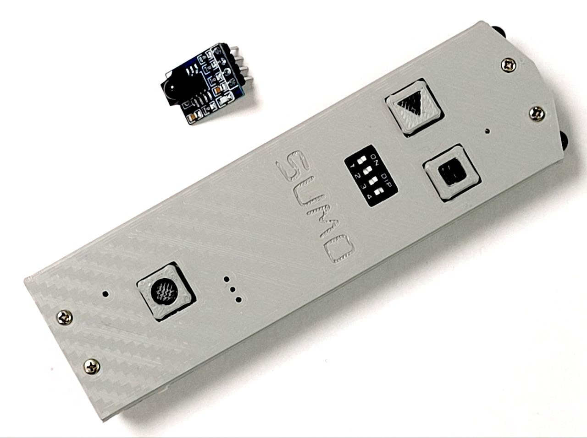

# Стартовый модуль и судейский пульт

#### В этом репозитории вы найдете необходимые материалы для самостоятельного изготовления стартового модуля и судейского пульта стандарта Robotchallenge. Оборудование соответствует требованиям многих мировых соревнований:
+ Robotchallenge
+ Robotex
+ Кубок по образовательной робототехнике (Беларусь)
+ Робофинист

Используется ИК-канал связи на частоте 38 кГц и протокол RC-5

## [DIY_edition](/DIY_edition/) - вместо стартового модуля используется датчик TSOP xx38, а пульт собирается на Arduino nano

## [pinMode_edition](/pinMode_edition/) - модуль и пульт, разработанные в клубе pinMode (Беларусь)

Печатные платы можно заказать на производстве, запаять, прошить их.
